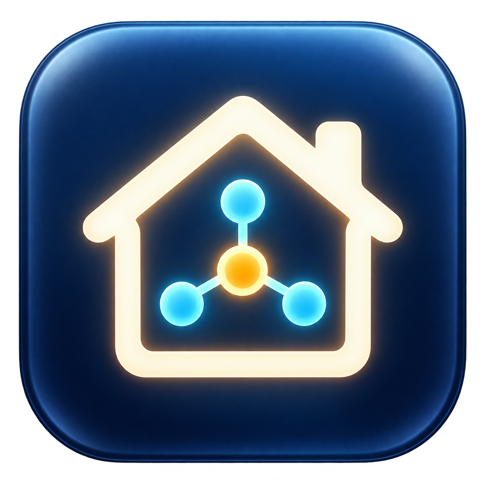

# CasaMenu

Aplicativo nativo para macOS que controla aparelhos domésticos pela barra de menus e por uma janela de administração. SwiftUI, Apple Silicon e macOS 14 ou posterior.

**Estado: protótipo funcional, ainda não um instalador de produção.** A instalação automática, o fluxo QR integrado ao aplicativo e a validação em um Mac limpo continuam pendentes.



## Funcionalidades

- Gree na rede local: descoberta, vínculo, energia, temperatura, modo, ventilação e recursos extras anunciados pelo aparelho.
- Tuya IR: energia, temperatura, modo e ventilação quando disponibilizados pela API. Credenciais ficam no computador do usuário.
- Ponte Homebridge para Casa/Siri. O plugin próprio oferece interruptor estável ou controle HeaterCooler opt-in, ainda em validação.
- Reconexão Gree, ícone no Dock, controle na barra superior e animação decorativa de vento.

A aceitação de um comando infravermelho pela nuvem **não comprova execução física**. A temperatura de referência no controle HomeKit sem sensor é a temperatura ajustada, não a temperatura ambiente. Não use essa referência como sensor para automações.

## Desenvolvimento

Pré-requisitos: macOS em Apple Silicon, ferramentas de linha de comando do Xcode (Swift) e Node.js 22 ou 24 LTS com npm. Node.js 24 é recomendado para reproduzir o ambiente testado.

```sh
cd HomeKit
npm ci --no-audit --no-fund
cd ..
./test.sh
./build.sh
open CasaMenu.app
```

A compilação usa assinatura ad hoc. Não há assinatura Developer ID nem notarização. Mantenha `HomeKit` ao lado do aplicativo durante o desenvolvimento. O app procura Node nos componentes locais ou nos caminhos comuns do Homebrew; `CASAMENU_NODE` permite indicar um executável em processos iniciados pelo terminal.

## Conectar aparelhos

1. No CasaMenu, descubra e vincule um Gree na mesma rede.
2. Execute `HomeKit/start.command` para preparar a ponte. O script atual exige ao menos um Gree vinculado para gerar a configuração inicial.
3. Abra o painel local da ponte em `http://127.0.0.1:8581`. Configure a conta no plugin Tuya sem conta de desenvolvedor e conclua a autorização no celular.
4. Consulte [a configuração do conector IR](docs/HOMEKIT.md) para publicar os comandos do escritório sem duplicar os acessórios vazios.
5. Pareie a ponte pelo aplicativo Casa do iPhone usando o QR HomeKit. É uma autorização separada da Tuya.

Dados privados ficam em `~/Library/Application Support/CasaMenu/homebridge-data`, salvo configuração explícita diferente. O repositório não contém autorizações, código de pareamento, inventário pessoal nem chaves dos aparelhos.

## Estrutura

| Pasta | Conteúdo |
|---|---|
| `Sources` | Aplicativo SwiftUI, modelos, drivers e caminhos de dados |
| `Assets` | Ícones próprios |
| `Resources` | Metadados do aplicativo |
| `HomeKit` | Ponte, lockfile npm, helper Tuya e plugin CasaMenu |
| `Tests` | Testes automatizados sem comandos aos aparelhos |
| `docs` | Integração, validação, produção e plano de negócio |

## Limites conhecidos

- A interface ainda contém cômodos e espaços de demonstração da instalação piloto; múltiplas residências precisam de generalização.
- O helper seleciona o aparelho pelo arquivo privado de seleção ou pelo primeiro IR compatível no cache. Não há seleção completa de vários aparelhos no onboarding.
- Turbo e oscilação do IR dependem de comandos reais disponibilizados pela Tuya.
- Alexa não está implementada. As luzes foram descobertas, mas os comandos da instalação piloto falharam e precisam de investigação.
- Instalação nova, reinício completo, repouso/despertar e estabilidade prolongada não estão certificados pelos testes atuais.
- O Mac deve estar ligado e acessível para que a ponte responda. Acesso remoto e requisitos de centrais Apple precisam ser configurados conforme o cenário.

## Testes e distribuição

`test.sh` testa criptografia/protocolo Gree, mapeamento Tuya, limites, falhas e características HomeKit. Não substitui validação física nem inspeção do Casa no iPhone. Veja [o registro de validação](docs/VALIDACAO.md) e [os critérios de produção](docs/PRODUCAO.md).

A licença original do repositório foi preservada em [LICENSE](LICENSE). Dependências mantêm suas próprias licenças; revise o conjunto antes de redistribuir runtimes e plugins. O [plano de negócio](docs/PLANO-DE-NEGOCIO.md) contém hipóteses, não preços aprovados ou previsões.
